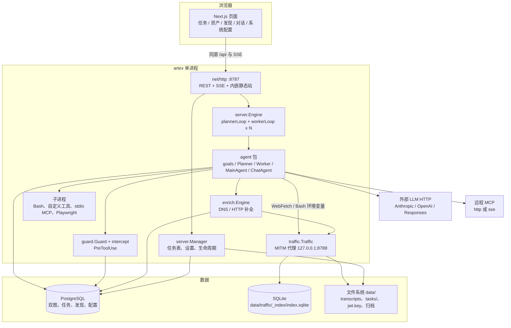
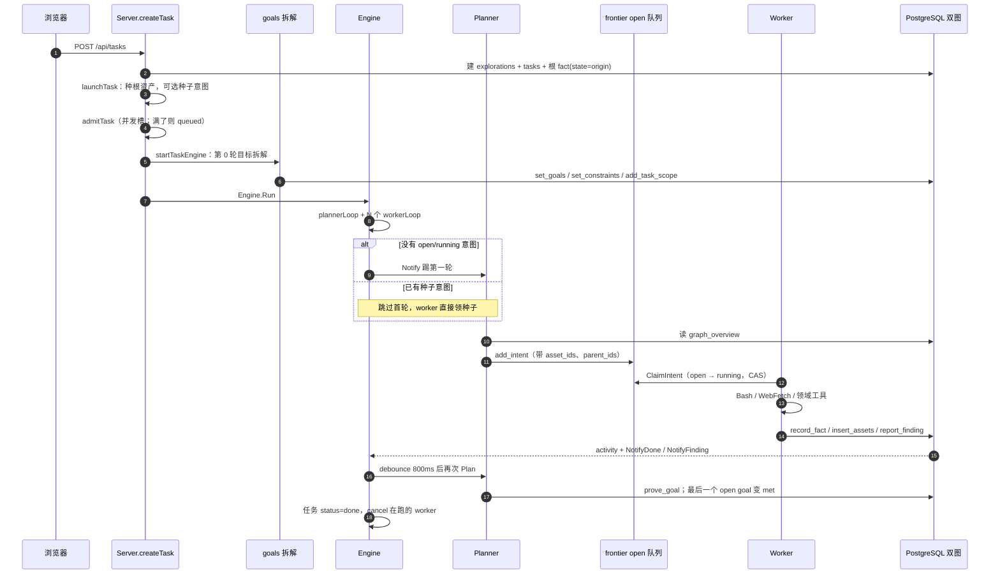
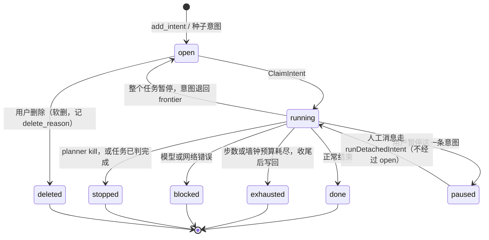

# ARTEX 代码架构与实现

本文是对仓库当前源码的**只读**架构说明：不运行程序、不安装依赖、不构建镜像、不对任何目标发请求。结论来自目录、`README.md`、`docker-compose.yml`、`db/schema.sql` 与 Go / TypeScript 源码。代码标识符、表名、工具名、环境变量保留原文。

阅读锚点：分支基于 `main` 提交 `a05a886`（`fix: support traffic ID copying over HTTP`）。文中「未确认」表示静态阅读无法判定运行时行为，集中见第 10 节。

本工作区**没有** `SECURITY_AUDIT.md`。安全边界只根据 `guard/`、`intercept/` 与相关注释描述，不引用那份不存在的审计。

---

## 1. 一句话定位与适用场景

ARTEX 是一套 **LLM 驱动的自主渗透测试编排系统**：一个 Go 进程同时提供 HTTP API、内嵌 Next.js 界面、任务引擎和流量记录代理，业务状态落在 PostgreSQL，流量索引另用 SQLite。

它要解决的问题不是「一个聊天机器人会调几个扫描命令」，而是把一次授权测试拆成可恢复、可审计的闭环：

- **资产图**回答「世界上有哪些对象」（跨任务共享的真值库）。
- **探索图**回答「这一次任务想到了什么、派了什么、证明了什么」（每任务一条推进链）。
- **规划者只产意图，执行者只做一条意图**，人通过主 Agent 改方向，而不是让单个 ReAct 循环一直跑到目标。

适用场景（按代码与 README 能支持的能力，而不是推荐用法）：

- 本地或 Docker 里研究「目标拆解 → 规划 → 多 worker 执行 → 写回双图 → 报告 / 复测」这条编排链路。
- 用 Web 界面看任务、探索血缘、资产覆盖、流量、拦截审批和 LLM 用量。
- 把技能（`skills/`）、MCP、自定义工具接到已有 Agent 上。
- 仓库自带的在线 Demo 只构建 `web/` 且 `NEXT_PUBLIC_MOCK=1`，**不连 Go、不连数据库、不发真实扫描**。

README 的许可与免责声明把使用范围限制在源码阅读和本地隔离验证，并禁止对线上系统发起测试。那是作者的使用约定，不是运行时强制开关。

---

## 2. 核心理念与设计取舍

### 2.1 双图，而不是一份聊天记录

系统把「目标是什么」和「测到了什么程度」拆开，再用锚点接上。README「系统技术架构」与 `db/schema.sql`、`db/constants.go` 一致：

| 图 | 生命周期 | 节点 | 谁写 |
| --- | --- | --- | --- |
| 资产图 `assets` / `companies` / `company_scope` | 全局一份 | `root_domain` / `subdomain` / `ip` / `service` / `app` / `endpoint` | `insert_assets`、资产 API、`enrich`、ScopeSentry 同步 |
| 探索图 `explorations` + `exploration_nodes` | 每个任务一张 | `goal` / `intent` / `fact` / `finding` / `hint` / `digest` | goals / planner / worker / mainagent |
| 锚点 `exploration_anchors` | 节点 ↔ 资产 | — | 写资产或事实时带上 `asset_ids` |

边只有五种（`db/constants.go`）：`spawns`、`derived_from`、`yields`、`proves`、`covers`。前四种是血缘（目标派生意图、意图产出事实、事实证明漏洞），`covers` 是冷节点摘要（digest）盖住被折叠成员。

资产的父子关系和去重键由程序算（`assets` 上按类型的部分唯一索引），模型只交原始字段。这是刻意的：不让 LLM 维护图的结构不变量。

### 2.2 为什么拆成 goals / planner / worker / mainagent

四个角色的职责在提示词里写成硬边界，引擎再按这个边界调度。

| 角色 | 进程内对象 | 一次运行的寿命 | 产出 |
| --- | --- | --- | --- |
| `goals` | `DecomposeGoals` | 任务启动时一次，最多 8 个回合 | `set_goals`、`set_constraints`、可选 `add_task_scope` |
| `planner` | `agent.Planner` | **每次唤醒都是新会话** | 0..N 条 `add_intent`，或 `prove_goal` |
| `worker` | `agent.Worker` × N 个 goroutine | 领到的**一条**意图，可从 transcript 续跑 | `insert_assets` / `record_fact` / `report_finding` |
| `mainagent` | `agent.MainAgent` | 人的每一句话是新 `Session`，但 `Resume` 旧 transcript | `add_hint`、高优先级 `add_intent`、`set_goals`、`steer_work` |

另外还有**不进这条引擎循环**的对话 Agent：内置 `auto`、`asset_mapper`、`pentest`，以及启动时种下的自定义 `reporter`、`retester`。它们走 `agent.ChatAgent` 和 `/chat`，用触发器或人手启动。

这样拆的原因，代码里写得很直：

1. **规划者和执行者不能是同一个人。** planner 提示词禁止在规划轮里把活干完；worker 提示词禁止自己开新方向，瞥见的线索只能写进 fact，交给下一轮 planner。
2. **串行攻击链不能一轮并行拆光。** planner 持有进程内 `actool.TodoStore`（按 `exploration id`），跨唤醒保留待办，每轮只派「前置 fact 已经存在」的下一步（`renderPlannerTodos`）。
3. **人要能插手，但不能接管自主循环。** mainagent 不跑意图生成循环；它写 hint 或直接注入高优先级意图，由引擎把已结束任务拉回 `running`。
4. **一次唤醒必须便宜、可丢弃。** planner 的态势（触发原因 + `graph_overview` JSON）放在当轮 user 消息里，system 保持相对稳定，便于提示缓存。worker 相反：领到的意图写进 **system**，因为 compaction 不能把「这条意图」压掉（`worker.go` 里的注释把这个取舍写明了）。

### 2.3 和常见三种编排的异同

**和 ReAct。** 单个 Agent 内部仍是 norma `agentcore` 的工具循环：模型输出 → 工具 → 观察 → 再问模型。`captureRun` / `captureRunSession` 把每步收成 `activity`（`thinking` / `tool_use` / `tool_result` / `text` / `result`）。差别在任务级：没有一个 ReAct Agent 从目标一直做到收工。任务级状态机是「图变更 → planner → frontier → worker → 写回 → 再唤醒」。

**和 Planner-Executor。** 外形很像：唯一意图生成者 + 多个执行者。差别有三点。

- planner **不是**事先产出完整计划再交给执行器。它是事件驱动的，多数唤醒可以合法地产出 0 个意图；硬底线是「目标未达成且 frontier 与 running 都空」时必须再派一条。
- 执行器**不能**回头改计划。新方向只能变成 fact / finding，等 planner 醒来。
- 计划草稿（TodoWrite）在 planner 进程内跨轮共享，但**不落库**。进程重启后这份待办消失，下一轮只能从图和 recent facts 重建。这是静态代码能确定的行为。

**和 Multi-agent。** 有多个具名角色，但它们不互相聊天、不投票、不共享一个消息总线。信息交换的通道是：

- 探索图与资产图（结构化、可查询）。
- `activity` 里的逐步轨迹，worker 用 `search_all_worker_traces` / `get_worker_trace` 读**别的意图**的过程，不读自己这条。
- mainagent → planner 的 hint / goal 触发（`TriggerEvent`）。
- planner → 正在跑的 worker：`steer_work`（下一工具调用前注入）和 `kill_work`（取消该意图的 context）。

没有「专家 Agent 组会」。`pentest` 是例外：它在对话页里一个人扮演规划、执行和自检，不进 `Engine`。

### 2.4 其他明确取舍

- **安全门不靠 SDK 的权限模式。** planner / worker / mainagent 都设 `permission.ModeBypass`。真正挡工具的是 `guard.Guard` 的 `PreToolUse`，再交给 `intercept` 规则（allow / deny / ask）和可选的 LLM 判定。`guard.go` 写明：原先的 RoE 授权范围机制已删除，破坏性操作改由数据库里的拦截规则承担。
- **工具的行为在代码里，散文在数据库里。** `tools` 表能改描述、JSON Schema 文案和标量默认值，能按 Agent 绑定或禁用，但改不了 `Call`。MCP、skill、流量工具没有内置行，原样透传。
- **提示词分段。** 段 [A] 可编辑，种进 `agent_prompts`；段 [B] 流量工具说明、段 [C] 工作目录规约、OPSEC 块、漏洞/情报工作流尾巴由代码在渲染后追加，用户改提示词删不掉。
- **图是长期记忆，transcript 是会话记忆。** 仓库没有引用 `norma/memory`。长期事实是 PostgreSQL 里的双图、`findings`、`task_intelligence`；原始对话是 `data/transcripts` 上的 norma `transcript.Store`。
- **冷节点压缩和对话压缩是两件事。** 对话用 norma `compaction`（按 context window）或实验开关 noa；探索图用 `Compactor` 把长期无下游的 intent/fact 折成 `digest` 节点，成员仍在，可 `expand_digest`。
- **单进程，不是 worker 集群。** `Engine` 为每个任务起 1 个 `plannerLoop` 和 N 个 `workerLoop` goroutine。N 来自全局 worker 数、任务覆盖或 worker pool（可把槽位钉死在某个 `llm_profiles.id`）。没有独立的 worker 进程或任务队列服务。
- **Schema 启动即迁移。** `db.Open` 在 advisory lock 里执行嵌入的 `schema.sql`（`IF NOT EXISTS` / 重建 CHECK）。README 称为「重启即迁移」。结构不会随版本回滚。

---

## 3. 整体架构图

### 3.1 组件与进程

生产形态（`docker-compose.yml`）是两个容器：`postgres:16-alpine` 与 `artex`。`artex` 容器里只有一个 PID 1（`start.sh` 拉起的二进制），下面这些都在**同一进程**里。



开发时 `./dev.sh` 把界面拆出去：`next dev` 在 `:5173`，`/api` 反代到 `:8787`。发布二进制用 `-tags embedui` 把 `web/out` 嵌进 `server/webui/dist`，仍由 `:8787` 同时提供页面和 API。

流量代理默认只绑在容器的 `127.0.0.1:8788`（compose 端口映射如此）。它记录的是**经过它的 HTTP**，不是所有出站流量。全局出口代理是另一条配置：抓包开着时作为 MITM 的上游，抓包关着时直接写进 Agent 的 `HTTP(S)_PROXY`。

### 3.2 一次渗透任务：从创建到收尾

创建入口是 `POST /api/tasks` → `Server.createTask` → `launchTask`。目标拆解在后台 goroutine 里做完，引擎才启动，避免 planner 抢在 goal 节点之前跑。



意图本身是一张小状态机。领取是一条条件更新：`state='open'` 才改成 `running`，多个 worker 抢同一条只会有一个成功（`ExplorationStore.ClaimIntent`）。



任务行 `tasks.status` 是另一套：`created` / `running` / `paused` / `done` / `failed` / `timeout`。`queued` 是单独的布尔，表示卡在并发上限里，还没占运行槽。`paused` 列和 `pause_reason` 与 status 并存：引擎用内存里的 `paused` map 取消正在跑的 context，数据库记下原因（例如计划任务暂停）。

收尾还有三条不走「再派意图」的路：

- **goalless。** 已经没有 `state=open` 的 goal 时，planner 不再调用 LLM。frontier 和 running 都空了，就把任务标 `done`。这是人通过 mainagent 直投意图、目标已全部 met 之后的收尾。
- **任务墙钟。** `timeout_seconds > 0` 时，第一次真正规划或执行会盖 `first_run_at` 和 `deadline_at`。进入 settling 后不再领新意图；在跑的 run 被夹到剩余时间，收尾词换成任务超时词。
- **心跳。** `plannerLoop` 除了 `t.notify`，还有定时器。创建任务时低于 600 秒会被抬到 `MinPlanHeartbeatSeconds`（10 分钟）。schema 列默认值仍写着 300，运行路径以代码下限为准。

`report_finding` 成功后还会另开一条线：`reporter` 对话 Agent（若已种下且启用）按触发器写 Markdown，并 `update_finding_report`。这条线不阻塞 worker 返回。

---

## 4. 目录与模块地图

### 4.1 顶层

| 路径 | 职责 |
| --- | --- |
| `cmd/artex/` | 进程入口：旗标、自更新引导、`Manager`、HTTP |
| `config/` | `config.json` 与 `ARTEX_PG_DSN` / `ARTEX_SKILL_DIR` |
| `server/` | HTTP、引擎、任务生命周期、装配技能与 MCP、报告/复测 API |
| `agent/` | 各角色的提示词、工具集、LLM provider、压缩 |
| `db/` | `schema.sql`（`go:embed`）与 pgx 访问 |
| `guard/` | 工具调用钩子与审计环 |
| `intercept/` | 规则匹配、人工审批等待、静态检查、Jev 判定 |
| `traffic/` | MITM 记录代理与 SQLite 索引 |
| `enrich/` | 资产写入后的异步 DNS / HTTP 补全 |
| `evidence/` | 漏洞流量快照，与可清理的原始流量脱钩 |
| `report/` | 从探索图渲染一份任务级 Markdown |
| `llmhttp/` `llmpool/` `llmrec/` | LLM HTTP 客户端、全局故障转移池、调用录制 |
| `mcphttp/` | 远程 MCP（Streamable HTTP / 旧 SSE） |
| `notify/` | 邮件、飞书、钉钉、企微、Telegram、Webhook |
| `selfupdate/` | 发布包替换与启动失败回滚；退出码 75 交给 `start.sh` |
| `skills/` | 每个子目录一个 skill，入口是 `SKILL.md` |
| `web/` | Next.js App Router 前端 |
| `sidequestion/` | `/btw` 旁路提问的设计笔记（实现在 `agent/side_questions.go` 与 `server/side_questions.go`） |
| `docs/` | 仅 `jev-integration-review.md`、`漏洞流量证据.md` |
| `docker-compose.yml` | postgres + artex |
| `Dockerfile` | 运行镜像：预编译二进制 + nmap/node/Playwright，不在镜像里编译 |

### 4.2 后端：按职责而不是按文件名

`server/` 有一百多个文件，按调用链可以收成这些包内模块：

| 模块 | 关键文件 | 做什么 |
| --- | --- | --- |
| 进程与路由 | `server/server.go`、`webui_embed.go`、`webui_stub.go` | `Server.New` 装配钩子；`mux.HandleFunc` 注册 `/api/*`；`embedui` 标签才内嵌前端 |
| 生命周期 | `server/manager.go`、`goals.go` | `Task` 内存对象、`NewManager`、并发准入、`launchTask` |
| 引擎 | `server/engine.go`、`engine_timeout.go` | planner/worker 循环、领取、暂停/杀死、超时协调 |
| 模型路由 | `server/task_llm.go`、`llmpool.go`、`llmretry.go` | 任务链、Agent 绑定、全局池、重试 |
| 工具装配 | `server/assembly.go`、`customtool.go`、`platform_tools.go`、`orchestration.go` | skill / MCP / 流量工具 / 自定义工具 / reporter 种子 |
| 发现与报告 | `server/finding_report.go`、`finding_cases.go`、`finding_retests.go`、`finding_traffic.go` | 报告触发、归并、复测、流量绑定 |
| 人在环路 | `server/conversations.go`、`intent_intervention.go`、`intercept.go` | 对话、给正在跑的意图发消息、审批 API |
| 资产与同步 | `server/assets.go`、`sync_scopesentry.go`、`task_assets.go` | 资产 CRUD、ScopeSentry 导入 |
| 计划任务 | `server/schedules.go`、`calendar_schedule.go`、`scheduler.go` | 日历调度与到点启动 |

`agent/` 里和编排直接相关的是：

| 文件 | 类型 / 函数 |
| --- | --- |
| `planner.go` | `Planner`、`Plan`、`TriggerEvent`、`plannerDefaultTmpl` |
| `worker.go` | `Worker`、`Execute`、`workerDefaultTmpl`、`proxyEnv` |
| `mainagent.go` | `MainAgent.Chat` |
| `goals.go` | `DecomposeGoals`、`GoalSpec` |
| `chat.go` | 对话页 Agent（`auto` / `pentest` / 自定义） |
| `prompt.go` | `renderSystem`、`PromptOverride`、`OpsecEnabled` |
| `promptcatalog.go` | `BuiltinPromptSeeds`、`ReporterDefaultPrompt` |
| `tools.go` / `tools_insert.go` | `ToolSet` 与领域工具 |
| `toolcatalog.go` | `BuiltinToolSeeds`、`ToolResolve`、`DecorateTool` |
| `assembly.go` | `AugmentTools` |
| `provider.go` | `Config`、`FromEnv`、`NewProvider` |
| `compaction.go` / `coldgraph.go` / `noa.go` | 图摘要与上下文压缩 |

`db/` 的核心是 `schema.sql`、`db.go`（连接与种子）、`exploration.go`（节点、边、frontier、activity）、`assets.go`、`findings.go`、`tasks.go`。

### 4.3 前端

`web/` 是 Next.js（`package.json` 名 `artex-web`）。页面在 `web/src/app/`：

| 路由组 | 代表页面 | 对应能力 |
| --- | --- | --- |
| `(auth)/` | `/login`、`/setup` | 首次管理员密码、登录 |
| `(main)/dashboard` | `/dashboard` | 总览、Token、活动 |
| `(main)/chat` | `/chat` | 对话 Agent |
| `(main)/function/tasks` | 列表与 `detail/` | 任务详情页签：总览、会话、图、覆盖、发现、报告、复测、拦截、广播 |
| `(main)/function/findings` | 列表、`detail/`、`case/` | 漏洞、统一报告、归并 |
| `(main)/function/` 其余 | assets、traffic、repeater、sync、workspace、schedules、commands、llm-records | 资产、流量、重放、同步、工作目录、计划、命令、LLM 录制 |
| `(main)/system/` | llm、agents、mcp、skills、tools、intercept、notify、logs、settings | 系统配置 |

侧边栏真源是 `web/src/navigation/sidebar/sidebar-items.ts`。数据请求集中在 `web/src/lib/`（含 `mock/`：`NEXT_PUBLIC_MOCK=1` 时不打真实 API）。图可视化用 `@antv/g6` 与 `@xyflow/react`。

前端不跑 Agent。它只是 `Server` 的客户端。

### 4.4 `skills/`

| 目录 | `SKILL.md` 的 name | 在本仓库里的角色 |
| --- | --- | --- |
| `skills/api-recon/` | `api-recon` | 前端接口侦察的操作说明，附 `scripts/`（静态提取与运行时采集） |
| `skills/playwright-cli/` | `playwright-cli` | 浏览器 CLI 说明；front matter 有 `allowed-tools` |
| `skills/scopesentry/` | front matter 写的是 `scopesentry-mcp` | 给外部 MCP 客户端看的 ScopeSentry 工具说明 |

技能**不是** Go 插件。`skill.LoadDir` 读目录，按**目录名**（不是 front matter 的 `name`）和 `agent_skill_visibility` 匹配，打成一个 `Skill` 元工具。模型调用 `Skill` 之后才解锁该技能声明的 MCP。`scopesentry` 目录名与 front matter 的 `name: scopesentry-mcp` 不一致；可见性表若按目录名 `scopesentry` 勾选，加载能对上，按 front matter 名勾选则对不上。这是静态读到的匹配规则（`server/assembly.go`）。

---

## 5. 核心实现

### 5.1 入口与配置加载

`main` 只负责把 `run` 的返回码交给操作系统。退出码 75（`selfupdate.ExitRestart`）表示 `start.sh` 应再拉起进程，用来完成二进制换装。

```53:68:cmd/artex/main.go
func run() int {
	var (
		addr    = flag.String("addr", ":8787", "HTTP listen address")
		dataDir = flag.String("data", filepath.Join(config.BaseDir(), "data"), "data directory for SQLite stores (default: data/ next to the executable)")
		proxy   = flag.String("proxy", "127.0.0.1:8788", "traffic recording proxy address (empty to disable)")
	)
	flag.Parse()

	server.BuildVersion = version
	server.StartLogCapture()
	action, upState := selfupdate.Bootstrap()
	server.SetBootUpdateState(upState)
	if action == selfupdate.Restart {
		return selfupdate.ExitRestart
	}
```

旗标注释仍写 “SQLite stores”。图存储已经迁到 PostgreSQL；`data/` 里剩下的 SQLite 是流量索引，另有 `jwt.key`、transcript、任务工作目录和归档包。`main.go` 文件头那句 “dual SQLite graph stores” 是过时注释。

启动顺序：自更新引导（可能直接退出）→ 读配置路径日志 → `server.NewManager(dataDir, proxyAddr)` → `server.New` → `ListenAndServe`。SIGINT/SIGTERM 或更新请求会关掉 HTTP，并带上 `agent.AbortShutdown`，让在跑的 Agent 能区分「进程要停」和普通取消。

配置只有两级文件项，其余在环境变量或数据库设置里。

```129:148:config/config.go
// PostgresDSN resolves the connection string with precedence:
//
//	env ARTEX_PG_DSN  >  config file (database.dsn, or assembled from fields)
func PostgresDSN() (dsn, source string, err error) {
	if v := strings.TrimSpace(os.Getenv("ARTEX_PG_DSN")); v != "" {
		return v, "环境变量 ARTEX_PG_DSN", nil
	}
	db := Load().Database
	// ... database.dsn，否则用 host/port/user/password/dbname/sslmode 组装
```

| 项 | 优先级 | 缺省 |
| --- | --- | --- |
| 配置文件路径 | `ARTEX_CONFIG` > 当前目录 `config.json` > 可执行文件旁 | 都没有则报「未找到数据库配置」，没有内置 DSN |
| `skill_dir` | `ARTEX_SKILL_DIR` > 文件 > `BaseDir()/skills` | 不存在会 `MkdirAll` |
| LLM | 环境变量可引导第一次；UI 的 `llm_profiles` 才是运行期来源 | 两者都没有时引擎空转，不模拟 |
| 数据目录 | `-data`，默认 `<BaseDir>/data` | `go run` 时 `BaseDir()` 退回当前目录 |

`config.json` 不放 API key。`config.example.json` 只示范 `database` 和 `skill_dir`。

`NewManager` 打开 Postgres、清掉重启后不可信的 run segment、恢复未完成复测、确保 LLM 录制表，然后可选启动流量代理和 `enrich`（4 个工人）。流量代理起不来只打日志并继续；流量删除暂存恢复失败则会让整个进程起不来。

### 5.2 Agent 编排与提示词结构

引擎在 `Server.New` 里接上「这个任务用哪一对 planner/worker」：

```191:197:server/server.go
s.engine.SetAuthoritativeAgentResolver(func(t *Task) (*agent.Planner, *agent.Worker) {
    if !s.taskRuntimeAvailable(t, "planner", "worker") {
        return nil, nil
    }
    b := s.agentsForTask(t)
    return b.pl, b.wk
})
```

`Engine.Run` 对每个任务只启动一次。循环一直活着，LLM 没就绪就空转。`plannerLoop` 的一轮是：

1. 收到 `t.notify` 或心跳。
2. 用 800ms 定时器把突发通知并成一轮（`NewEngine` 里 `debounce: 800 * time.Millisecond`）。
3. 暂停、删除、终态、settling、没有 open goal 时直接返回。
4. `planner.Plan(...)`，把 `drainTriggers()` 的 `TriggerEvent` 传进去。
5. 若 `GoalMet`，`SetTaskStatus(done)` 并 `cancelExec(AbortGoalMet)`。

worker 侧 `claimNext` 取 frontier 前 20 条，逐条 `ClaimIntent`。执行完按 `harness.TerminalReason` 写回状态：出错 `blocked`，`ReasonMaxTurns` / `ReasonTimeout` 为 `exhausted`，否则 `done`。额度耗尽的任务链错误会写成 `IntentBlockedLLMQuota`，而不是普通 blocked。`model_error` 在仍属于本 work、且任务没暂停/没收尾时最多再试 2 次，间隔 3 秒。额度类错误不再整段重放这条意图。

提示词分三层拼出来：

1. `renderSystem(agentKey, 内置模板, vars)`：数据库里有当前版本就用数据库，Go `text/template`，`missingkey=error`。渲染失败退回内置模板。
2. 若 `OpsecEnabled()` 为真，追加固定 OPSEC 段。开关默认关，存在 settings 里。
3. 调用方再追加代码尾巴：worker 的流量工具说明（仅当记录代理 CA 存在）、工作目录规约、约束块、以及 `deferredSystem` 附上的漏洞/情报/deferred-tools 说明。

planner 的可编辑正文以「你是规划者、不是执行者」开头，决策顺序是：读预取态势 → `prove_goal` → 仅开局允许极少探测 → 比对 open/running/recent_done → 一次 `add_intent`。提示词要求每轮最多提交 4 个最高价值方向；`addIntent` 的实现按数组逐条写入，没有这条数量上限。recent_done 要看 `state`：`done` 不原样重派；`exhausted` / `blocked` 先读 trace 再决定续派、重派或换方向。

worker 的可编辑正文要求边做边写回，三种工具不要串图：资产进 `insert_assets`，结论进 `record_fact`，确认漏洞进 `report_finding`。否定结论必须带 `evidence` 和 `confidence`（`observed` 或 `inferred`）。

mainagent 只观察和操舵。`set_goals` 会把已完成或暂停的任务拉回运行；`add_intent` 的 priority 提示用 8–10，让它排到 frontier 前面（frontier 按 `priority DESC, id ASC`）。

goals 拆解把「最终可核验结果」和「攻击步骤」分开，并先抽 allow/deny 约束。约束文本要求写成具体主机，不能写「当前目标」，因为约束会脱离原文注入到后续 system prompt。LLM 一条 goal 都没写出时，`createGoals` 把原始任务目标当成唯一 goal。这里**没有**规则分词回退（注释写明旧的规则切分会把 URL 切碎）。

对话页上的 `pentest` 不遵守上述分工：提示词要求它自己铺路线、自己执行、自己用另一条路径复核。`auto` 则操作平台（建任务、改 skill、改 MCP），不亲自做测试。`asset_mapper` 只读资产。

预算：`agents.max_turns`（0 表示不限）、`agents.run_seconds`（列默认 1200，作用在 worker 墙钟）、以及任务级 `timeout_seconds`。撞到预算时 norma 的 settlement 阶段仍会跑一轮收尾；worker 在收尾里禁用 `Bash`，把已经识别的事实写回。收尾词可由 `wrapup_prompt` 覆盖。

### 5.3 工具注册、调用与权限 / 沙箱边界

一次运行的工具列表按这个顺序叠：

1. 角色自带的领域工具：`PlannerTools` / `WorkerTools` / `MainAgentTools`。
2. norma `DefaultTools()`。worker 去掉 `MultiEdit`、`Glob`、`Grep`，检索交给 Bash。
3. `AugmentTools`：可见 skill 的 `Skill` 元工具、可见 MCP 展开成的工具、host 工具（流量、编排、自定义工具）。
4. `ToolResolve`：按 `tools` 表丢掉未绑定或禁用的内置工具，套上改写后的描述和默认值。
5. `findingWorkflowTools` / `findingCaseWorkflow` / `intelligenceWorkflow` 按开关补说明或剥掉流量字段。
6. 每个工具再包一层 `guardPanic`，handler panic 变成工具错误，避免打垮进程。

worker 的领域工具面是有意收窄的：

```653:664:agent/tools_insert.go
func (t *ToolSet) WorkerTools() []actool.CoreTool {
	return []actool.CoreTool{
		t.listFindings(),
		t.addFinding(), t.recordFact(), t.recordIntelligence(),
		t.insertAssets(), t.listAssets(),
		t.searchAllWorkerTraces(), t.getWorkerTrace(),
		t.nodeDetail(),
	}
}
```

`add_company_scope`、`list_facts`、`list_companies`、`list_worker_traces` 不给 worker。规划侧才有 `add_intent`、`prove_goal`、`kill_work`、`steer_work`、`add_task_scope`、`list_untested_assets`。`goal_met` 会绕过逐个 `prove_goal` 直接宣布任务完成，种子数据里默认不绑给任何 Agent。

调用链：

```text
模型 tool_use
  → norma harness
  → steerHooks.PreToolUse（注入 steer 文本，或挡住空转）
  → guard.preToolUse
  → intercept.Match（priority 高的规则先看）
       allow：记审计，执行
       deny：工具结果写成「平台管控，不是目标的拦截」
       ask：写 intercept_pending，阻塞到人决定或超时
       无规则：可选 LLM/Jev 判定，否则放行
  → 工具 Call（领域工具写 Postgres；Bash 起子进程）
  → guard.PostToolUse（只对 Bash 做 blocked/error/ok 计数）
  → activity 落库 + SSE
```

`PermissionMode` 是 `ModeBypass`，所以 norma 自带的工具允许名单**不是**这套系统的安全边界。边界实际是：

| 层 | 有什么 | 没有什么 |
| --- | --- | --- |
| 提示词 | 操作约束（allow/deny）、可选 OPSEC、角色红线 | 运行时强制。模型可以不遵守 |
| 拦截规则 | `intercept_rules`：按工具名或参数做字符串/正则，动作 allow/deny/ask | 默认规则的具体条目要看种子数据；本文不逐条展开 |
| 人工审批 | `intercept_pending`，超时动作可配 | 没人点就按超时策略走 |
| 资产拦截 | `asset_intercept_rules`、`task_intercept_rules` | 与工具拦截是另一张表，管的是资产访问面 |
| 工作目录 | planner/main：`data/tasks/<taskID>`；worker：`.../i<intentID>` | 不是 chroot，也不是每意图一个容器。提示词禁止写 `/tmp`，代码没有再拦绝对路径 |
| 出站 | `BashEnv` 注入 `HTTP(S)_PROXY` 与 CA 环境变量；WebFetch 走同一代理 | 抓包关闭时没有 traffic_* 工具。不经过代理的协议不会出现在流量库 |
| 子进程 | Bash、自定义 `command`/`script`/`shell`、stdio MCP，工作目录在上面的 run dir | 与 artex 同用户、同容器。Docker 镜像里的 nmap、node、chromium 就是这个进程能 exec 的程序 |

自定义工具（`server/customtool.go`）的 `kind` 为 `command`、`script`、`http`、`shell`。`script` 只跑 Python，把参数 JSON 喂给 stdin，临时文件在 `workDir/.tools`。`http` 由进程自己发请求，可配代理。这些工具经 hostTools 注入，再按 `tools.agents` 过滤。

MCP：`mcp_servers.transport` 为 `stdio`、`http` 或 `sse`。直接可见且未被 skill 门控的工具，会话一开始就能调；写在技能 `mcps:` 里的服务器要等 `Skill` 被调用才解锁。浏览器 MCP 的截图工具默认不暴露，只有 `reporter` 且系统设置打开报告截图时才放行。

`intercept` 里还有对 shell / Python 片段的静态检查（`shell_static.go`、`python_shell_environment.go`）和可选的 Jev 判定模型。Jev **不能**当作聊天 provider：`Config.NewProvider` 对 `Jev=true` 直接返回错误。

### 5.4 记忆、状态与任务持久化

记忆没有单独的向量库或 `norma/memory` 适配器。分层是：

| 层 | 放哪 | 活多久 | 谁读 |
| --- | --- | --- | --- |
| 资产真值 | `assets` 等 | 跨任务，直到删除 | 所有能 `list_assets` 的 Agent；任务默认只看本任务及关联任务，`share_global_assets` 才放宽查询 |
| 探索图 | `exploration_nodes` / `edges` / `anchors` | 跟随任务；归档打进包 | planner 的 `graph_overview`；worker 只拿去掉 coverage 的态势 |
| 逐步轨迹 | `activity` | 跟随探索 | UI、`get_worker_trace`、reporter |
| 原始对话 | `data/transcripts`，session id 见下 | 文件，Resume 时加载 | 同一意图重跑、mainagent 多轮、对话页 |
| planner 待办 | `Planner.todos map[int64]*TodoStore` | **进程内存** | 只有这个任务的后续规划轮 |
| worker 待办 | 每次 `NewTodoStore()` | 这次 Execute | 模型自己的草稿，退出即丢 |
| 冷图摘要 | `kind=digest`，边 `covers` | 库内 | `graph_overview` 用摘要代替冷节点；`expand_digest` 展开 |
| 对话压缩 | norma compaction，或 `data/noa/<session>` | 文件 / 请求内 | 该会话 |
| 旁路提问 | `side_question_sessions` / `side_question_requests` | 库内，与主 transcript 分开 | `/btw`，不写回任务图 |
| 任务情报 | `task_intelligence` | 跟随任务归档 | 开关默认关；关上时不向 Agent 注入工具 |

Session id 是稳定的，所以暂停后续跑对得上文件：

- planner：`exp<explorationID>-planner`
- worker：`exp<explorationID>-worker-i<intentID>`（用意图 id，不用会复用的 `work#N`）
- mainagent：`exp<explorationID>-main`，新建会话段是 `exp<explorationID>-main-s<seg>`
- goals：`exp<explorationID>-goals`（只为网关的 session 头，不挂 transcript store）

任务行本身在 `tasks`：目标、状态、LLM 链、公司、心跳、覆盖开关、worker 数、运行时段、软删除。并发排队用 `queued` + `queued_at`，FIFO 看入队时间而不是创建时间。

冷归档：`task_archives` 在库里只留状态和进度，完整载荷是 `data/archives/tasks` 下的 `.tar.zst`。README 写当前格式为 v4，仍能读 v1–v3。归档实现在 `server/task_archive_package.go` 与 `db/task_archives.go`。恢复会把图、发现、情报等放回热表。旁路提问的设计笔记写归档会先停主流程再落旁路数据。

删除任务有内存屏障：`Engine.BeginDelete` 之后不再接收新的任务内写，等 planner/worker goroutine 退出再删库。这是为了避免删除过程中 Agent 还在 `INSERT`。

`activity.detail` 不进列表接口，按 id 再取。终端那条 `kind=result` 才带 token 计数。

### 5.5 与 LLM 的接口、模型切换

norma 的 `llm.Provider` 是唯一出站接口。`agent.Config` 描述一个端点：`Format`（`anthropic` / `openai` / `openai-responses`）、BaseURL、Key、Model、代理、思考开关、流式、`MaxTokens` 字段名、会话头、三层重试。

环境变量只用于**还没有 UI 配置时**的引导（`FromEnv`）：

- `ARTEX_LLM_PROVIDER`：`anthropic`（默认模型名 `claude-opus-4-8`）、`openai`（默认 `gpt-4o`）、`openai-responses`（默认 `gpt-5`）。
- Key：`ANTHROPIC_API_KEY` 或 `OPENAI_API_KEY`。
- 可选 `ARTEX_LLM_MODEL`、`ARTEX_LLM_BASE_URL`、`ARTEX_LLM_PROXY`、`ARTEX_LLM_STREAM`。

UI 里每条 `llm_profiles` 是一份可保存的 Config。任务运行时不直接用 `FromEnv`，而用 `taskLLMRuntime`。它实现 `Stream` 和 `Complete`，套在 planner/worker 的 `Provider` 位置上。选择顺序写在 `current()`：

1. **槽位钉死**（worker pool 的 `ProfileID`）：只用这一份，无效就报错，不改去别的模型。
2. **Agent 绑定** `agents.llm_profile_id`：该角色一直用绑定模型。
3. **任务链** `task_llm_profiles`：按 `position` 排。当前项额度耗尽才把 `tasks.active_llm_profile_id` 拨到下一项。认证失败和 5xx **不**因此换模型。
4. **全局激活配置**，再没有才是环境变量装起来的那份。

额度判断是故意收窄的（`IsQuotaExhaustedMessage`）：只认余额、账单、额度用尽一类文案，以及没有速率限制字样的 `resource_exhausted`。普通 429、401、403、5xx 留在当前 provider 上重试。`quotaAwareTransport` 把「明确余额耗尽的 429」改写成 402，好让任务路由立刻 failover，而 norma 默认会把所有 429 当暂时错误重试。

还有一条**全局**轮询，和任务链不是同一个东西：`llmpool.Pool` 按优先级串起多个 profile，`llm_profile_health` 做熔断冷却。`pool_exclude` 的配置不进故障转移，仍可被 Agent 或任务显式绑定。绑定模型默认独占；只有同时打开「LLM 池」和「绑定失败回退」时，`poolForBinding` 才把绑定包进池。

流式是默认。profile 的 `streaming=false` 时走 `Provider.Complete`。已经向调用方吐出文本或 tool_use 之后，池不会把同一次请求再发给下一个模型，否则历史会重复。同 provider 的断流重试只发生在「还没交付任何输出」的窗口，参数在 `RetryConfig.Stream*`，由 `server/task_llm.go` 消费，SDK 看不到这一层。

每次重建 Agent 会话都会重新读非流式和 `MaxTokens`，所以改 profile 不用重启进程。`ContextWindowK` **不**发给服务商，只用来算本地压缩阈值，夹在 32K 到 1M，未设置时按 200K。

`llmrec` 在开关打开时把请求/响应记到库里，供「LLM 录制」页查看。默认关。

旁路提问 `/btw` 直接打**当时快照里的那个 Provider**，不走任务 failover 链，也不起 agent session，因此模型若返回 tool_use，没有执行器去跑。

### 5.6 结果、报告与产物

一条「确认漏洞」会同时留下两份记录：

- 探索节点 `kind=finding`。登记时由意图经 `yields` 连到该节点（`db/finding_traffic.go`）。`proves` 不在上报时建立：planner 调用 `prove_goal` 时，才把证据节点连到 goal 并标 `met`。
- 独立表 `findings`：`task_id` 可空（任务删了发现还在，`ON DELETE SET NULL`），含 `vulnclass`、`name`、`severity`、`summary`、`evidence`、`status`、`report`。

`report_finding` 的返回把两个 id 分开：`finding_id` 是表主键，`finding_node_id` 是探索节点。旧的 `update_finding_report` 参数名仍叫 `finding_id`，但注释要求传入节点 id。流量工具用表主键。这个双 id 是阅读报告链路时最容易看错的地方。

严重度是 `critical` / `high` / `medium` / `low`。处置状态由服务端白名单校验，不在 SQL CHECK 里：`pending`、`in_progress`、`confirmed`、`resolved`、`fixed`、`false_positive`、`ignored`、`duplicate`、`risk_accepted`。

报告有三条产出路径，不要混成一个函数：

| 路径 | 代码 | 产物 |
| --- | --- | --- |
| 任务级简报 | `report.Markdown` | 标题、目标、资产计数、按严重度排序的发现和 PoC。给导出/概览，不是 reporter 写的长文 |
| 单条详细报告 | `reporter` Agent + `update_finding_report` | `findings.report` 里的 Markdown。结构在 `ReporterDefaultPrompt`：概述、影响、范围、复现步骤、证据、PoC、根因、修复 |
| 归并文件夹 | `finding_cases` 及成员、建议、评审表 | 同一任务里 Reporter 判定为同一根因的原始发现。原始报告不被覆盖。导出默认每组一份统一报告 |

流量证据是可选的。绑定进 `finding_traffic_bindings`，正文快照在 `traffic_evidence_snapshots` 和 `evidence` 包的文件里，这样原始流量被清掉之后报告仍能引用。开关关闭时，`report_finding` 会忽略模型多传的 `traffic_refs`，而不是因此拒绝整条漏洞。

复测是另一个对话 Agent `retester`（`db.FindingRetestAgentKey`）。`finding_retests.verdict` 为 `reproduced`、`fixed` 或 `inconclusive`。只有会话成功且结论为 `fixed` 时，服务端才把漏洞状态改成已修复。复测不重启原来的扫描任务。

工作目录里的脚本、响应体、报告截图（`findings/screenshots/finding-<id>-step-<n>.png`）是文件系统产物，不进 PostgreSQL。大工具输出被 norma 截断后落到该次运行的 `cmd-output/`。

任务情报（凭据、线索）在 `task_intelligence`，默认不注入工具。`insert_assets` 带上的服务 `auth` 在开关打开时会记成未验证凭据。

通知（`notify/`）是出站副作用：发现或任务事件可以发到邮件和 IM。它不参与编排正确性。

---

## 6. 数据流与关键类型

### 6.1 任务

内存对象是 `server.Task`（`manager.go`）。和库里的 `tasks` 行一起看，运行期字段（重连、触发队列）不进 JSON 给前端的那些用 `json:"-"`。

持久化列里和编排相关的是：`description`、`goal`、`exploration_id`、`status`、`paused`、`queued`、`llm_profile_id`、`active_llm_profile_id`、`llm_chain_revision`、`timeout_seconds`、`plan_heartbeat_seconds`、`coverage_enabled`、`share_global_assets`、`worker_count`、`first_run_at`、`deadline_at`。

`task_relations` 是创建时选定的只读继承，不递归。`task_scope` 是覆盖率分母：`kind` 可为 `company`、`root_domain`、`subdomain`、`ip`、`cidr`、`icp`、`keyword`，`source` 为 `auto`、`agent` 或 `manual`。

### 6.2 探索节点与边

```67:84:db/exploration.go
type Node struct {
	FindingID     int64           `json:"finding_id,omitempty"`
	FindingNodeID int64           `json:"finding_node_id,omitempty"`
	ID            int64           `json:"id"`
	Kind          string          `json:"kind"`
	Payload       json.RawMessage `json:"payload"`
	Priority      int             `json:"priority"`
	State         string          `json:"state"`
	Origin        string          `json:"origin,omitempty"`
	Owner         string          `json:"owner,omitempty"`
	BlockedReason string          `json:"blocked_reason,omitempty"`
	DeleteReason  string          `json:"delete_reason,omitempty"`
	Anchors       []int64         `json:"anchors,omitempty"`
	// ...
}
```

`payload` 是 JSON，没有单独的意图表。常见形状：

| kind | payload 字段 | state |
| --- | --- | --- |
| `fact` 且为任务根 | 任务起点 | `origin` |
| `goal` | `text`、`vulnclass` | `open` / `met` / `abandoned` |
| `intent` | `summary`、`asset_ids`。`parent_ids` 只能是已有 fact/finding，代码会拒绝意图、目标、提示；边是父节点 `--derived_from-->` 意图。没有父节点时自动连到 origin fact。planner 提示词仍写「派生自某上游意图也可以传」，和 `addOneIntent` 的校验不一致，以代码为准 | `open` `running` `paused` `done` `blocked` `exhausted` `stopped` `deleted` |
| `fact` | `summary`、`detail`、`evidence`、`confidence` | `confirmed` / `dismissed` |
| `finding` | `vulnclass`、`name`、`severity`、`summary`、`evidence.poc` | `confirmed` / `dismissed` |
| `hint` | 文本，可带 `traffic_refs` | `active` / `consumed` |
| `digest` | 冷节点摘要正文 | `active` / `superseded` |

`TriggerEvent`（`agent/planner.go`）是「这一轮为什么醒」：`done`、`finding`、`goal`、`goal_deleted`、`goal_edited`、`hint`、`cancelled`。心跳唤醒时切片为空，提示词会改成巡检口吻，而不是假装图变了。

### 6.3 步骤（activity）

```87:96:db/exploration.go
type Activity struct {
	ID        int64           `json:"id"`
	NodeID    *int64          `json:"node_id,omitempty"`
	Worker    string          `json:"worker,omitempty"`
	Kind      string          `json:"kind,omitempty"`
	Tool      string          `json:"tool,omitempty"`
	ToolUseID string          `json:"tool_use_id,omitempty"`
	IsError   bool            `json:"is_error"`
	Summary   string          `json:"summary,omitempty"`
	Detail    string          `json:"-"`
	Metadata  json.RawMessage `json:"metadata,omitempty"`
```

`Worker` 对 planner 步骤是 `"planner"`，对 mainagent 是 `"mainagent"`，对某次执行是槽位名（如 `work#1`），`NodeID` 指向意图。`Kind` 来自捕获循环：`round` 是轮次分隔，其余是模型步骤。`tool_usage` / `skill_usage` 是只记维度、不记正文的账本，故意不设外键，任务删了统计还在。

### 6.4 工具调用在数据里长什么样

模型侧是 norma 的 tool use（名字 + JSON 参数）。落到业务库时：

- 过程：`activity.tool`、`tool_use_id`、`is_error`、`summary`，全文在 `detail`。
- 统计：`tool_usage` 一行一次 `Call`。
- 拦截：`intercept_pending.tool_name` + `tool_input` JSON，状态 `pending` / `allowed` / `denied` / `timeout`。
- 写回计数：`ToolSet.WriteCounts`（事实、资产、漏洞、情报），只存在这次运行的内存里，引擎拿去打日志，不是一张表。

`record_fact` 可以是单条，或 `facts` 数组。`add_intent` 同样是一批 `intents`。

### 6.5 漏洞

`findings` 行见 `schema.sql` 的 L 段。归并用 `finding_cases`、`finding_case_members`、`finding_case_suggestions`（人工确认前的建议）、`finding_case_blocks`（否决后不要自动再并）。复测用 `finding_retests`，同一漏洞同时只允许一条 `pending` 或 `running`。

`report.findingView` 是简报用的扁平结构：`VulnClass`、`Name`、`Severity`、`Summary`、`PoC`。

### 6.6 资产

`assets.type` 只能是 `root_domain`、`ip`、`subdomain`、`app`、`service`、`endpoint`。HTTP 服务按 `url` 唯一，端点按 `(url, method)` 唯一，子域按 `(domain, record_type)` 唯一。`company_source` 区分人指定的 `explicit` 和从 `company_scope` 推出来的 `scope`。`task_asset_links` 记录某个资产是怎么进这个任务的；`assets.task_ids` 数组仍是兼容用的关联。

---

## 7. 扩展点

### 7.1 加一个领域能力（要改代码）

内置工具的 `Call` 在 `agent/tools.go` 与 `agent/tools_insert.go`。步骤是：

1. 在 `ToolSet` 上写一个 `actool.CoreTool`（`readExpTool` / `writeExpTool` 包了空库保护）。
2. 放进 `PlannerTools`、`WorkerTools` 或 `MainAgentTools`。`builtinToolsByAgent` 会在下次启动时把它收进 `BuiltinToolSeeds`。
3. `wireTools` 只在该 key **还没有行**时插入 `tools` 表。已经存在的描述不会被新二进制覆盖。
4. 若工具会改图且 planner 应该马上知道，接上 `notify` / `notifyFinding` / `notifyGoal`。

不要用数据库改 handler。UI 上改 schema 只能改模型看见的说明和标量默认值。

### 7.2 加一个技能

在 `ARTEX_SKILL_DIR`（或默认 `skills/`）下新建目录，放 `SKILL.md`。目录名就是可见性表里的 `skill_name`。在 Agent 管理里把该技能勾给目标 Agent。运行时 `skill.LoadDir` 再按目录名过滤，打成 `Skill` 工具。技能若在 front matter 里声明 `mcps:`，那些 MCP 服务器要已在 `mcp_servers` 里，且会保持锁定直到模型真的调用了 `Skill`。

`playwright-cli` 的 `allowed-tools` 是给技能文档看的约定。本仓库的 Go 装配路径**没有**读取这个字段来过滤 Bash；工具允不允许以 Agent 的工具绑定和拦截规则为准。

改技能不用重编镜像：compose 把 `./skills` 挂进 `/app/skills`。

### 7.3 加一个自定义工具或 MCP

- 自定义工具：`POST` 到工具 API（`pgCreateCustomTool`），`key` 规则与 Agent key 相同（小写字母开头）。`kind` 四选一，`agents` 决定谁能看见，`deferred` 则 schema 不进主提示、走 deferred 工具块。
- MCP：在 `mcp_servers` 增加 `stdio`、`http` 或 `sse`。每个 Agent 用 `agent_visibility` 勾服务器。stdio 会在**该次 Agent 运行**时拉起子进程，运行结束 `cleanup` 关掉。连接失败只打日志，不让整次任务失败。

`auto` 的提示词允许它调用 `create_skill` / `create_custom_tool` / `create_mcp`。那是平台工具，不是另一套注册表。

### 7.4 加一个对话 Agent

`db.CreateAgent` 插入 `builtin=false`、`role=assistant`。提示词用 `DefaultAssistantPrompt` 起步，可在 UI 改。它不会出现在 `Engine` 里。要让它在某工具被调用时醒来，用 `agent_triggers`（`server/triggers.go` 只允许自定义 Agent）。`reporter` 就是这条路的实例：`seedReporterAgent` 建 Agent、绑工具、把触发策略设为 `parallel` + `none`（一条漏洞一次运行，最多 5 路）。种子用 settings 旗标守着，用户删掉之后不会自动重建。

内置四个编排角色的 `key` 是保留的，不能靠这个 API 换成别的 role。`agents.role` 的 CHECK 只有 `goals`、`main`、`planner`、`worker`、`assistant`。

### 7.5 接一个新模型

不需要改代码，只要端点符合三种格式之一：

1. 系统配置里新建 `llm_profiles`：provider、model、base URL、key、代理、流式、思考、输出上限字段、上下文窗口、重试覆盖。
2. 设为全局默认，或绑到某个 Agent，或放进任务的有序链，或放进 worker pool 的槽位。
3. OpenAI 兼容网关若只认 `max_completion_tokens`，把 `MaxTokensField` 设成那个名字。代码不会凭模型名猜测。
4. 需要会话粘性的网关，填 `SessionHeaderKey`。头的值来自 context 里的 session id。

第四种协议只有 Jev，而且只给拦截判定。新的聊天协议要改 `agent.Config.NewProvider` 和 norma 的 `llm.Format`，那已经是 fork SDK 或升级 `github.com/Autumn-27/norma` 的范围。`go.mod` 里 norma 版本是 `v0.4.3`。

---

## 8. 复现与部署要点（只整理，不执行）

以下内容来自 `README.md`、`docker-compose.yml`、`.env.example`、`Dockerfile`、`config.example.json`，没有在本环境里跑过。

**依赖。** PostgreSQL。探索要 LLM：环境变量或 UI。Go `1.26.10`（`go.mod`）。前端是 Node 上的 Next.js；发布工作流用 Node 22。

**Compose（`docker-compose.yml`）。**

- `postgres`：`postgres:16-alpine`，库名/用户默认 `artex`，密码必须来自 `.env` 的 `POSTGRES_PASSWORD`，卷 `pgdata`。
- `artex`：镜像 `${ARTEX_IMAGE:-ruoji6/artex}:${ARTEX_TAG:-latest}`。
- 环境：`ARTEX_PG_DSN` 指向服务名 `postgres:5432`，以及可选的 `ANTHROPIC_API_KEY`、`OPENAI_API_KEY`、`ARTEX_LLM_*`。
- 端口：`8787` 对外；`8788` 只映射到宿主机环回。
- 卷：`./data:/app/data`，`./skills:/app/skills`。
- 时区写死 `Asia/Shanghai`。

`.env.example` 把镜像默认设为 `ruoji6/artex`、标签 `latest`。

**进程怎么起来。** 镜像 `ENTRYPOINT` 是 `/app/start.sh`，参数 `-addr :8787 -proxy :8788`。不要绕过 `start.sh` 直接跑二进制，否则页面上的一键更新换完二进制没有人再拉起它。`Dockerfile` 注明二进制是 CI 事先编译好再 `COPY` 的，镜像本身不编译 Go/Next。

**本地二进制。** `config.example.json` 复制为 `config.json`，填 database。示例端口是 `5433`，和 compose 对外不暴露的 `5432` 不是同一套假设：本地若自己映射 Postgres，要和文件一致。然后 `./start.sh`。首次打开 `http://localhost:8787/setup` 设管理员密码。

**从源码编出带界面的二进制（README 步骤，此处未执行）。** `web` 里 `npm run build:static`（`NEXT_EXPORT=1`）→ 拷到 `server/webui/dist` → `CGO_ENABLED=0 go build -tags embedui -o artex ./cmd/artex`。不加 `embedui` 时 `webui_stub.go` 不提供内嵌页面。

**开发。** `./dev.sh`：后端 `:8787`、流量代理 `:8788`、前端 `:5173`。Mock：`web` 下 `NEXT_PUBLIC_MOCK=1`。

**反代。** 页面和 API、SSE 同源，一般不用 `NEXT_PUBLIC_SSE_BASE`。SSE 必须关缓冲。`/api/health` 在打开 HTTP Basic Auth 之后也要带凭证；版本号在要 JWT 的 `/api/version`。

**升级。** 换二进制或镜像，不换 `pgdata` 和 `./data`。启动时重放 `schema.sql`。页面更新会中断正在跑的任务。Docker 里只替换容器内二进制不会升级镜像里的 nmap/Playwright；重建容器会回到镜像自带的程序。

**`docker-compose.bench.yml`。** 另一条测评用编排：`Dockerfile.bench`、`network_mode: host`、不映射端口。与生产 compose 无关。仓库里能看到这个文件；`bench/.env` 与 `Dockerfile.bench` 是否齐全，以树为准（本次只确认了 compose 文件本身）。

---

## 9. 阅读路线

建议按「一条任务怎么活」读，而不是按目录字母序。

1. `README.md` 的「系统技术架构」。它和代码一致的部分是双图、角色和引擎闭环；后面再核对过时注释。
2. `cmd/artex/main.go` → `config/config.go` → `server/manager.go` 的 `NewManager` 与 `Task`。弄清进程里有什么。
3. `db/schema.sql` 的 A（资产）、B（探索）、D（任务）、E（Agent）、K（拦截）、L（发现）。配合 `db/constants.go`。
4. `server/goals.go` 的 `launchTask` / `startTaskEngine` / `createGoals`，然后 `server/engine.go` 的 `Run`、`plannerLoop`、`workerLoop`、`runIntent`、`claimNext`。
5. `agent/planner.go`、`agent/worker.go`、`agent/mainagent.go` 的 `Plan` / `Execute` / `Chat`，以及 `agent/prompt.go` 的 `renderSystem`。先看系统提示怎么拼，再看工具列表。
6. `agent/tools_insert.go` 末尾三个 `*Tools()`，再在 `agent/tools.go` 里看 `addIntent`、`recordFact`、`addFinding`、`proveGoal`。
7. `server/assembly.go` 的 `wireAgentAugment` 和 `agent/assembly.go` 的 `AugmentTools`。这是技能和 MCP 进入模型的唯一路径。
8. `guard/guard.go` 再 `intercept/intercept.go` 开头。确认安全门在钩子上，不在 `ModeBypass`。
9. `server/task_llm.go` 的 `current()` 与 `agent/provider.go`。然后才有必要看 `llmpool/pool.go`。
10. 产物：`agent/promptcatalog.go` 里的 `ReporterDefaultPrompt`、`report/report.go`、`server/finding_report.go`、`db/findings.go` 的记录函数。
11. 前端只在要追某个页面时再打开：`web/src/navigation/sidebar/sidebar-items.ts` 定位路由，再到 `web/src/app/(main)/function/tasks/detail/`。

想改某一刀时的最短路径：

- 改规划口吻：`agent_prompts` 里 planner 的当前版本；代码默认在 `plannerDefaultTmpl`。别指望能改掉工作目录尾巴。
- 改 worker 能调用什么：`WorkerTools` 加 `tools` 表绑定。只改表而不在 base 列表里的工具，解析阶段留不住。
- 改「什么时候再规划」：`plannerLoop` 与 `Task.Notify` / `NotifyDone` / `NotifyFinding`。
- 改模型切换：`taskLLMRuntime.current`，不要只改 `FromEnv`。

---

## 10. 未确认与缺口

静态阅读确定不了、或仓库自相矛盾的点：

- **没有 `SECURITY_AUDIT.md`。** 无法对照一份独立审计。`guard` 注释说 RoE 已删除；`enrich/enrich.go` 文件头仍写 HTTP 探测受 RoE 约束，但 `ProbeSite` 只是入队，未见 RoE 判断。以 `guard.go` 为准更合理，enrich 那句视为过时注释。未运行，不能证明探测是否还受别的开关限制。
- **planner 提示词与 `add_intent` 校验不一致。** 可编辑提示词允许 `parent_ids` 填上游意图；`addOneIntent` 只接受 fact/finding，否则整条意图创建失败。这是源码能确定的分歧，实际模型更常听哪一边没有运行记录。
- **注释指向的设计文档大多不在树里。** `provider.go` 提到 `docs/ARTEX-架构设计.md`；schema 注释提到 `docs/LLM轮询设计.md`、`docs/LLM重试设计.md`、`docs/任务级超时与收尾设计.md`、`docs/planner-trigger-impl-plan.md`；`customtool.go` 提到 `docs/自定义工具设计.md`；`enrich.go` 提到 `docs/资产模型与自动关联设计.md`。`docs/` 下只有 Jev 回顾和漏洞流量证据两篇。冷摘要注释里的 “cold-digest spec” 也没有单独文件，算法就在 `agent/coldgraph.go` 与 `agent/compaction.go`。
- **`main.go` / `Dockerfile` 仍把 `data/` 叫 SQLite 图库。** 图在 PostgreSQL。SQLite 仅流量索引（及测试里的内存库）。
- **planner 待办重启后丢失** 是代码事实（内存 map）。重启后模型能否只靠图把串行链接上，取决于下一轮 LLM 输出，无法静态判定。
- **心跳默认值不一致。** 列默认 300 秒；`normalize` 与 `plannerHeartbeatInterval` 把小于 600 的值抬到 600。旧行若从未走过创建归一化，引擎仍会按 600 跑。未确认 UI 展示的是列值还是抬升后的值。
- **内置拦截规则的具体正则**没有在本文逐条抄录。规则在启动种子里，且用户可删。不运行数据库就看不到某一套部署的当前规则。
- **Bash 是否真的走了代理**取决于子进程是否尊重 `HTTP_PROXY` / `SSL_CERT_FILE`。代码只注入环境变量。不尊重这些变量的程序会直连，也不会留下流量。未做实验。
- **技能 front matter 的 `allowed-tools`、`name` 与目录名**是否被 norma `skill.LoadDir` 另作他用，要看模块源码（在依赖里，不在本仓库）。本仓库调用点只按目录名过滤。
- **norma 的 `agentcore` 在预算耗尽时如何打断正在跑的工具**，本仓库注释说墙钟会打断并进入 settlement。打断的精确语义在 SDK 内，未打开模块源码逐行核对。
- **Demo 与生产数据是否一致**不由这套 Go 代码保证。Mock 在 `web/src/lib/mock/`，README 写明要人工跟着版本改。
- **`docker-compose.bench.yml` 引用的 `Dockerfile.bench` 与 `bench/.env` 不在本仓库。** 只有 compose 文件。测评镜像的构建参数因此未核实。
- **并发默认 worker 数。** `Manager.Workers` 在 settings 缺失或非法时返回 `defaultWorkers = 3`，与 README 一致。库里若已保存别的值，以库为准。未打开 UI 核对展示文案。
- **资产共享打开之后，worker 是否会把查询结果当成授权范围。** 提示词写「共享不代表扩大测试授权」，拦截是否覆盖这个缺口取决于规则配置，不是类型系统保证的。

---

## 附录：角色和工具对照

| Agent key | role | 谁启动它 | 默认领域工具（种子） |
| --- | --- | --- | --- |
| `goals` | `goals` | 任务创建后的第 0 轮 | `set_goals`、`set_constraints`，有资产库时再加 `add_task_scope` |
| `planner` | `planner` | `plannerLoop` | 读图、`add_intent`、`prove_goal`、`kill_work`、`steer_work`、资产与范围 |
| `worker` | `worker` | `workerLoop` | 写回三类 + 跨 work trace |
| `mainagent` | `main` | 任务内对话 | 读图、`add_hint`、`add_intent`、`set_goals`、`set_constraints`、`steer_work` |
| `auto` | `assistant` | `/chat` | 漏洞与资产工具，外加平台编排工具 |
| `asset_mapper` | `assistant` | 拓扑/资产视图 | `list_assets`、`list_companies` |
| `pentest` | `assistant` | `/chat` | 查/写资产、报/查漏洞、查企业 |
| `reporter` | `assistant`（自定义，可删） | `report_finding` 触发器 | 读任务图与轨迹、`update_finding_report`、流量绑定 |
| `retester` | `assistant`（自定义） | 人在漏洞上点复测 | 由复测种子绑定，见 `server/finding_retests.go` |

SDK 通用工具（Read、Write、Edit、Bash 等）不在 `tools` 种子里，每个编排角色默认都有，worker 少三个检索/批量编辑工具。
